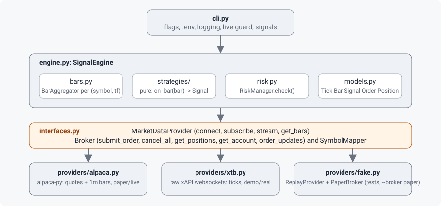

# Architecture

This chapter maps the code: which module owns what, the canonical models everything is expressed in, the two interfaces that separate the engine from the outside world, and the rules that keep that separation intact.

## Modules

| Path | Owns |
|---|---|
| `tradesignals/cli.py` | Argument parser, `.env` loading, logging setup, the live-account guard, SIGINT/SIGTERM handling, wiring of one strategy into one engine |
| `tradesignals/engine.py` | `SignalEngine`: lifecycle, warm-up, event loop, signal emission, execution, broker state cache, kill switch |
| `tradesignals/bars.py` | `bucket_start()` and `BarAggregator`: ticks and finer bars become bars of the strategy's timeframe |
| `tradesignals/indicators.py` | Incremental `SMA`, `EMA` (unused by the built-in strategies) and Wilder `RSI` |
| `tradesignals/strategies/` | `Strategy` base class, `SmaCross`, `RsiReversion`, and the `REGISTRY` the CLI reads |
| `tradesignals/risk.py` | `RiskLimits` (with `from_env()`) and `RiskManager.check()` |
| `tradesignals/models.py` | Canonical dataclasses and enums, `utcnow()` |
| `tradesignals/interfaces.py` | `MarketDataProvider`, `Broker` (abstract) and the concrete `SymbolMapper` |
| `tradesignals/config.py` | `env_bool()`, the strict boolean parser used for the paper/demo flags |
| `tradesignals/providers/__init__.py` | `DATA_PROVIDERS` and `BROKERS` registries of zero-argument factories; `make_data()`, `make_broker()` |
| `tradesignals/providers/fake.py` | `ReplayProvider` and `PaperBroker`: no network, reference semantics, used by tests and by `--broker paper` |
| `tradesignals/providers/alpaca.py` | `AlpacaData`, `AlpacaBroker` on top of alpaca-py |
| `tradesignals/providers/xtb.py` | `XtbSession`, `XtbData`, `XtbBroker` speaking xAPI JSON over websockets directly |
| `tradesignals/__main__.py` | `python -m tradesignals` entry point |

## Canonical models (`tradesignals/models.py`)

Everything that crosses the provider boundary is one of these. Adapters translate provider payloads into them at the boundary; the only provider type that leaks upward is the `raw` field of `Order`, which carries the provider's own object or dict for debugging.

| Model | Fields (defaults) | Notes |
|---|---|---|
| `Tick` (frozen) | `symbol, bid, ask, ts, source, last=None` | `.mid`, `.price` (= `last` if set, else mid). Neither adapter sets `last`, so `.price` is always the mid. |
| `Bar` (frozen) | `symbol, timeframe, open, high, low, close, volume, start, source` | No end time and no "complete" flag; a bar handed to a strategy is complete by construction. |
| `Signal` (frozen) | `symbol, kind, strategy, ts, strength=1.0, reason=""` | `kind` is `LONG`, `SHORT` or `FLAT`; `strength` is documented as 0..1 but not validated (`tradesignals/models.py:149`). |
| `OrderRequest` | `symbol, side, qty, type=MARKET, limit_price=None, tif=DAY, client_order_id=uuid4().hex, note=""` | `tradesignals/models.py:97-100`. `note` is never forwarded to a broker. |
| `Order` | `id, client_order_id, symbol, side, qty, status, filled_qty=0.0, avg_fill_price=None, ts=utcnow(), source="", raw=None` | `ts` is the time the object was built, not the broker's timestamp. |
| `Position` | `symbol, qty (signed), avg_price, market_value=None, unrealized_pnl=None, provider_ref=None` | `provider_ref` holds the XTB position id. |
| `Account` | `equity, cash, buying_power, currency="USD"` | |

Enums: `Side` (buy/sell), `OrderType` (market/limit), `TimeInForce` (day/gtc), `OrderStatus` (new, accepted, partially_filled, filled, cancelled, rejected, unknown; `.is_terminal` is true for filled, cancelled and rejected, `tradesignals/models.py:45`), `Timeframe` (1m, 5m, 15m, 1h, 1d with `.seconds`), `SignalKind` (long, short, flat).

All datetimes are timezone-aware UTC. `utcnow()` is the only clock; adapters convert provider timestamps at the boundary.

## The two interfaces (`tradesignals/interfaces.py`)

`MarketDataProvider` (class attributes `name`, `pushes_bars=False` at `tradesignals/interfaces.py:38`):

| Method | Contract |
|---|---|
| `connect()`, `close()` | Open and close network resources. |
| `subscribe(symbols)` | Subscribe to live ticks, and bars where the provider pushes them. |
| `stream()` | Async iterator of `Tick` and `Bar` events "until closed". |
| `get_bars(symbol, timeframe, start, end=None)` | Historical bars, oldest first; used for warm-up. |

`Broker` (class attributes `name`, `paper=False` at `tradesignals/interfaces.py:66`): `connect()`, `close()`, `submit_order(req) -> Order`, `cancel_order(id)`, `cancel_all()`, `get_order(id)`, `get_positions()`, `get_account()`, `order_updates()` (async iterator; poll-based adapters emulate it).

`paper` is deliberately `False` on the base class: an adapter that forgets to set it is treated as live, and the CLI then refuses `--execute` without `--allow-live`. `pushes_bars` tells the engine never to build bars from ticks for that provider (see [Data flow](data-flow.md)).

**What the contract leaves unspecified** (every adapter answers differently; see [Provider adapters](providers.md)):

- whether `stream()` ever ends (Replay ends, Alpaca never, XTB ends when the socket closes);
- whether `connect()` and `subscribe()` are idempotent (Alpaca's `subscribe()` is not);
- which exceptions are raised, and whether `submit_order()` returns a terminal status;
- whether `get_bars()` treats `end` as inclusive and whether it includes the bar in progress;
- whether `order_updates()` re-emits orders that were already terminal.

**What the contract lacks**: a way to list open orders, a flatten-position call, and a way to pass configuration into a factory (the registries call constructors with no arguments, so all configuration comes from environment variables).

`SymbolMapper(suffix="", overrides=None)` converts canonical symbols (`AAPL`) to provider symbols (`AAPL.US_9`) and back. Only the XTB adapter uses it; Alpaca passes symbols through unchanged. Overrides cannot be configured from the CLI.

## Registries

- `tradesignals/providers/__init__.py:40-48`: `DATA_PROVIDERS = {"alpaca", "xtb"}` and `BROKERS = {"alpaca", "xtb", "paper"}` map names to factories that import their module lazily, so alpaca-py is only needed when `alpaca` is selected. An unknown name raises `KeyError`; the CLI prevents that through argparse choices.
- `strategies/__init__.py`: `REGISTRY` keyed by each class's `name` attribute: `sma_cross`, `rsi_reversion`.

The CLI builds strategies as `REGISTRY[name](symbols, timeframe=...)`, so every registered strategy must accept `symbols` positionally and `timeframe` as a keyword even though the base class only takes `symbols`. See [Adding a strategy](../develop/adding-a-strategy.md).

## Import rules

`CLAUDE.md` states that the engine and strategies import only from `models.py`, `interfaces.py`, `strategies/` and `risk.py`, and never a provider module. In practice `engine.py` also imports `bars.py` and strategies import `indicators.py`; both are pure, provider-free modules, so the intent holds. Nothing enforces the rule automatically; a test that walks the import graph would be a cheap addition (see the [Tester guide](../../tester/gates/test-debt.md)).

The invariants that matter:

1. Adapters emit only canonical models with canonical symbols.
2. Strategies are pure: `on_bar(bar) -> Signal | None`, no I/O, no broker access.
3. `engine.py` is the only module that submits orders, and when a `RiskManager` is present every order passes `check()` first. The CLI always passes one when a broker is named (`tradesignals/cli.py:118`); a program embedding the engine may pass `risk=None` and bypass the checks.
