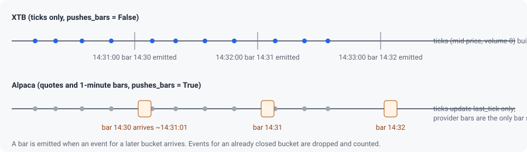

# Data flow: ticks, bars and warm-up

This chapter follows a price from the provider to the strategy: how buckets are aligned, when a bar is emitted, which source builds bars when a provider pushes both quotes and bars, and how the warm-up window is computed.

## Buckets are UTC clock multiples

`bucket_start(ts, tf)` (`tradesignals/bars.py:17`) floors the epoch time to a multiple of the timeframe's seconds. Consequences:

- An hourly bar starts on the UTC hour. During US regular hours (13:30 to 20:00 UTC in winter) the first hourly bar is a half-hour stub from 13:30 to 14:00.
- A daily bar starts at 00:00 UTC, not at the exchange session. With `--timeframe 1d` a single session's prices land in one UTC day only because the US session never crosses UTC midnight.
- Nothing is aligned to market open or close. If you need session-aligned bars, that is a new aggregator.

## One aggregator per (symbol, timeframe)

`SignalEngine._agg()` creates a `BarAggregator` per `(symbol, strategy.timeframe)` on demand. `BarAggregator._update()` (`tradesignals/bars.py:44-62`) does three things:

1. **Late events are dropped.** An event whose bucket starts *before* the current bucket is ignored and counted in `dropped_late` (`tradesignals/bars.py:47-51`). Re-opening the old bucket would emit it twice and throw away the bar in progress.
2. **A new bucket completes the old one.** When an event lands in a later bucket, the current bar is returned as complete and a fresh bar starts with that event's price.
3. **Same bucket updates high, low, close and volume.**

A bar is therefore emitted only when a *later* event arrives. There is no timer. The last bar of a session is emitted by the first event of the next session, which can be the next day; its `Signal.ts` is the bar's start time (yesterday) while execution happens at today's price. A gap in the data produces no bars at all.

Bars built from ticks use `Tick.price`, which is the mid (no adapter sets `last`), and carry volume 0. Bars rolled up from finer provider bars (`on_bar()`, `tradesignals/bars.py:34-42`) feed open, high, low and close in sequence and add the volume.

## Which source builds bars

Alpaca streams quote ticks *and* one-minute bars for every subscribed symbol. Feeding both into one aggregator hands every bucket to the strategy twice: once built from mids when the next minute's first quote arrives, and once more when the provider's bar for that minute arrives a second later (which, for 5-minute strategies, also resurrected the previous bucket before late events were dropped).

The rule now is **provider bars win**:

- A provider declares `pushes_bars = True` (`AlpacaData`, `tradesignals/providers/alpaca.py:89`). The engine then never feeds ticks into aggregators for that provider (`tradesignals/engine.py:75` sets `_ticks_build_bars`, checked at `tradesignals/engine.py:183`). Ticks still update `last_tick` (used by the risk checks and the paper broker marks) and still reach `Strategy.on_tick()`.
- As a safety net for an adapter that forgets the declaration, the first provider bar seen for a symbol switches that symbol over (`tradesignals/engine.py:198-203`). Only the buckets before that first bar can be tick-built.
- `ReplayProvider(events, pushes_bars=True)` emulates a bar-pushing provider in tests (`tests/test_engine_robustness.py`).

With provider bars at 1 minute and a strategy at 5 minutes, the provider's bars roll up through the same aggregator; the 5-minute bar is emitted when the first 1-minute bar of the next 5-minute bucket arrives, about one minute after the bucket closes.

> **Note.** Warm-up bars (from `get_bars()`) and live tick-built bars have different price bases: history is trade-based OHLC, live XTB bars are mid-based with zero volume. Alpaca is consistent in both because its live bars are also trade bars.

## Multiple strategies

The CLI runs one strategy. A program embedding the engine may pass several. Aggregators are keyed by `(symbol, timeframe)` and shared, so two strategies on the same symbol and timeframe feed the same aggregator once per strategy (`tradesignals/engine.py:179-196`): only the first strategy in the list receives the completed bar, and rolled-up volume is added once per strategy. Give each strategy its own timeframe or symbol set until this is fixed (listed in [Known gaps](../develop/known-gaps.md)).

Events for symbols that no strategy handles are dropped silently (`tradesignals/engine.py:186`, `tradesignals/engine.py:205`). A wrong XTB suffix therefore produces zero events and no error.

## Warm-up

`SignalEngine._warmup()` (`tradesignals/engine.py:131-150`) runs once per strategy before subscribing to live data, unless `--no-warmup` was given:

1. `start = utcnow() - timeframe.seconds * warmup_bars * 3` (`tradesignals/engine.py:135`): three times the required span, to allow for gaps and closed hours.
2. `get_bars(symbol, timeframe, start)` per symbol. A failure logs `warmup <strategy>/<symbol> failed: ...` at WARNING and the strategy starts cold for that symbol.
3. The last `warmup_bars` bars are fed to `on_bar()`; any signals they produce are discarded.
4. Fewer than `warmup_bars` bars log `only N of M bars available; strategy starts cold` at WARNING (`tradesignals/engine.py:146`); enough bars log `warmup <strategy>/<symbol>: N bars` at INFO.

Because the window is anchored to the wall clock, the amount of history depends on when you start:

| Strategy | `warmup_bars` | Window | Enough history when |
|---|---|---|---|
| `sma_cross` (1m) | 31 (`tradesignals/strategies/sma_cross.py:16`) | 93 minutes | more than 31 minutes after the open |
| `rsi_reversion` (5m) | 42 (`tradesignals/strategies/rsi_reversion.py:18`) | 10.5 hours | always during a session, because the window reaches into the previous session |

The warm-up history may include the bucket in progress. The first live bar of that bucket can then be partial or duplicate the history's last bar. Nothing de-duplicates by `start` yet.

## Timestamps

- Provider timestamps are converted to aware UTC at the adapter boundary (`alpaca.py` uses `astimezone(timezone.utc)`, `xtb.py` converts epoch milliseconds).
- `Signal.ts` is the bar's start, not the moment of the decision.
- Log lines use the machine's local time (`logging.basicConfig` default format).
- `RiskManager.check()` compares the last tick's `ts` with `utcnow()`; the engine never passes an event-time `now`, which is why replay tests disable the quote-age check with a huge limit.
