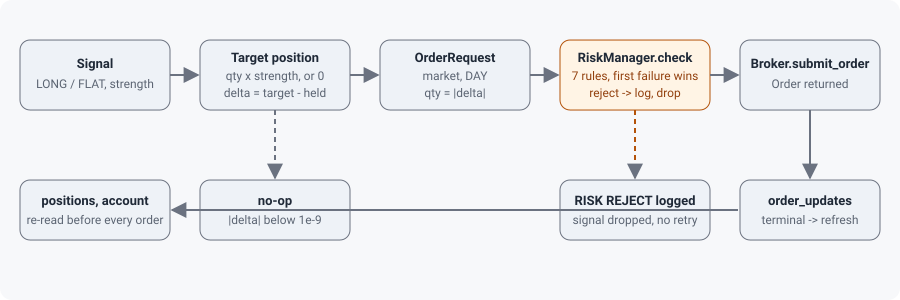

# Execution and risk

This chapter follows a signal to the broker and back: how a target position becomes an order request, the seven risk rules in the order they run, what the engine does with the broker's answer, and what the kill switch really does.

## From signal to order request

`SignalEngine._emit()` (`tradesignals/engine.py:496-507`) records the signal, publishes it on the event bus, logs the `SIGNAL` line, calls the optional `on_signal` callback (a returned coroutine is awaited; a returned Future is not), and, only when `execute` is on, calls `_act()`.

`execute` is on only when both `--execute` was given *and* a broker exists (`tradesignals/engine.py:102`). `--execute` without `--broker` silently runs signal-only; the CLI logs a warning about it (`tradesignals/cli.py:145`).

`_act()` (`tradesignals/engine.py:509-534`) sizes the order while holding the engine's order lock, so that a signal, a flatten and a manual order can never size against each other's half-finished work:

1. Re-reads positions and account from the broker (`_refresh_broker_state()`, `tradesignals/engine.py:627`). A failure logs `broker state refresh failed` at WARNING and keeps the previous values.
2. Re-reads any order that has been open for more than 30 seconds (`_reconcile_open_orders()`, `tradesignals/engine.py:559`), in case its push update was lost.
3. Held quantity = the broker's position **plus the unfilled part of every order still in flight** (`_pending_qty()`, `tradesignals/engine.py:536`).
4. Target position: `LONG` → `default_qty × strength`, `SHORT` → `−default_qty × strength`, `FLAT` → `0`.
5. `delta = round(target − held, 4)`. If `|delta| < 1e-9` the engine logs `no-op` and returns.
6. Builds `OrderRequest(symbol, side=BUY if delta > 0 else SELL, qty=|delta|, note="<strategy>:<kind>")`. Every strategy order is a **market order, time-in-force DAY** (`tradesignals/models.py:97-99`); `note` is never sent to a broker; `client_order_id` is a fresh uuid4 hex.

`_submit()` (`tradesignals/engine.py:586-625`) is the one path every order takes, whether it comes from a strategy, from a flatten or from the console's order ticket:

1. If a `RiskManager` is present, `check()` runs against the positions *as they will be once the open orders have filled*. A rejection logs `RISK REJECT <side> <qty> <symbol>: <reason>` at WARNING and drops the order. There is no retry and no queue.
2. `broker.submit_order(req)`. An exception logs `submit failed` with a traceback and drops the order.
3. The returned `Order` is appended to `engine.orders` (the latest 1000; the database keeps all of them), tracked as open until it reaches a terminal state, published on the event bus and logged as `ORDER <source> <side> <qty> <symbol> -> <status> (<id>)`.

Each of the four outcomes (order sent, nothing to do, blocked by risk, submit failed) is published as a `SignalOutcome`, which is how the console can say what happened to every signal.

An exception raised by a strategy or by the `on_signal` callback aborts handling of that event; the engine logs `error handling <event>` with a traceback and continues with the next event (`tradesignals/engine.py:429-444`).

## The risk rules

`RiskManager.check(req, last_tick, positions, account, now=None)` (`tradesignals/risk.py:43-85`) returns `(ok, reason)`. Rules run in this order and the first failure wins:

| # | Rule | Default limit | Reject reason | Line |
|---|---|---|---|---|
| 0 | The order only reduces an existing position, without crossing zero | — | passes at once with `ok: reduces position`; no later rule runs | `tradesignals/risk.py:55` |
| 1 | Manager is halted | — | `halted: <reason>` | `tradesignals/risk.py:57` |
| 2 | No last tick for the symbol | — | `no quote` | `tradesignals/risk.py:60` |
| 3 | `now − tick.ts > max_quote_age_sec` (`now` is the wall clock) | 15 s | `stale quote (Ns)` | `tradesignals/risk.py:63` |
| 4 | `qty × (limit_price or tick.price) > max_order_notional` | 2000 | `notional N > L` | `tradesignals/risk.py:65-66` |
| 5 | `abs(held + signed qty) > max_position_qty` | 50 | `position would be N > L` | `tradesignals/risk.py:72` |
| 6 | New symbol and `len(positions) >= max_open_positions` | 5 | `max open positions (L)` | `tradesignals/risk.py:74` |
| 7 | With an account: `start_equity − equity > max_daily_loss` sets `halted` and rejects | 200 | `daily loss N > L` | `tradesignals/risk.py:76-84` |

`start_equity` is captured the first time `check()` runs with an account (`tradesignals/risk.py:76`), so "daily" means "since this process first checked". The halt is a latch: once set it stays set until the process exits or an operator resumes trading from the console, which clears the halt and restarts the loss baseline at the next account value (`RiskManager.resume()`, `tradesignals/risk.py:90`).

`check(..., commit=False)` answers "would this pass?" without latching a halt or fixing the baseline; the console's order preview uses it.

Facts that follow from the rules, all verified in code and covered by `tests/test_risk.py`:

- **Exits always pass.** An order that only shrinks a position towards zero skips every rule (`reduces_position()`, `tradesignals/risk.py:97`): a halt, the notional cap or a stale quote can no longer trap you in a position. An order that would cross zero opens new risk and is judged like any other. Nothing flattens automatically; the console can flatten on request.
- **The loss rule is skipped when the account is unknown** (`account is None`), which is the case when the first refresh failed. Refresh failures therefore fail open.
- **Limits are in the quote's currency** (order notional) and the account's currency (loss). On XTB with a non-USD account those differ.
- `buying_power` and `cash` are never read by the engine or the rules.
- Positions opened by hand or by another program count: rule 6 counts every position on the account, and `_act()` treats any position in the symbol as its own.
- There is no order throttle, cooldown or hysteresis: a strategy that flips every bar trades every bar.

`check()` accepts an event-time `now`, but the engine always lets it default to `utcnow()`. Replay tests therefore run with `max_quote_age_sec=10**9`.

## Broker state and order updates

`_consume_order_updates()` (`tradesignals/engine.py:635-657`) iterates `broker.order_updates()`, logs each update as `ORDER UPDATE ...`, and re-reads positions and account when the update is terminal. If that stream raises, the engine logs `order update stream failed; continuing without push updates` at ERROR and keeps trading: positions are re-read before every order anyway. If the *data* stream raises, the engine logs `data stream failed; stopping engine` and stops (`tradesignals/engine.py:442`), because without prices nothing useful can happen.

## Kill switch

`SignalEngine.kill_switch()` (`tradesignals/engine.py:174-184`): logs `KILL SWITCH ...` at WARNING, sets `risk.halted` with reason `kill switch`, calls `broker.cancel_all()`, and in a `finally` block calls `stop()` so the loop ends even if cancelling fails.

What it does **not** do: flatten positions. And what cancels depends on the broker:

| Broker | `cancel_all()` |
|---|---|
| paper | no-op; nothing ever rests on a book |
| alpaca | cancels **every** open order on the account, including ones this engine did not place (`tradesignals/providers/alpaca.py:223`) |
| xtb | deletes every pending (limit/stop) order on the account; open positions untouched (`tradesignals/providers/xtb.py:348`) |

`SIGINT`/`SIGTERM` are mapped to `engine.stop()` (`tradesignals/cli.py:189`), a clean stop that cancels nothing and flattens nothing. The kill switch is reached from the admin console (Risk page) or the terminal UI (`k`), both of which ask for the word `STOP` first; see [The admin console](../console/README.md).

## Operator controls

These `SignalEngine` methods are what the console calls; a program embedding the engine can call them too. All of them go through `_submit()` when they send an order, so risk is never bypassed.

| Method | Effect |
|---|---|
| `halt(reason)` / `resume()` | set or clear the risk halt; a halt blocks new and larger positions, never exits |
| `flatten(symbol=None)` | market order closing one position or all; skips a position whose closing order is already in flight |
| `submit_manual(req)` / `preview_order(req)` | an operator's order through risk; the preview changes nothing |
| `cancel_order(order_id)` | pass a cancel to the broker |
| `set_risk_limits(**changes)` | replace limits for the rest of the run |
| `pause_strategy(id)` / `resume_strategy(id)` | ignore or accept a strategy's signals; it keeps receiving bars |
| `add_strategy(strategy)` / `remove_strategy(id)` | start (after warm-up, on symbols already subscribed) or stop a strategy; positions are left alone |

## Shutdown

`run()` (`tradesignals/engine.py:128-169`) wraps connect, warm-up, subscribe and the wait for `stop()` in one `try`; the `finally` cancels the consumer tasks, closes the data provider and then the broker even if closing the data provider raised, and logs `engine stopped`. A failure during `broker.connect()` therefore still closes the data connection.
