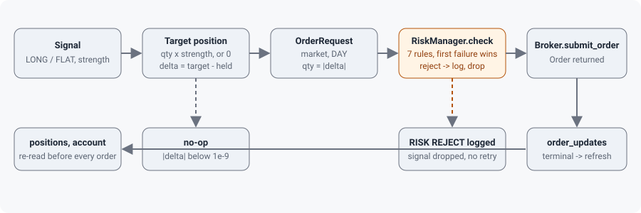

# Execution and risk

This chapter follows a signal to the broker and back: how a target position becomes an order request, the seven risk rules in the order they run, what the engine does with the broker's answer, and what the kill switch really does.

## From signal to order request

`SignalEngine._emit()` (`tradesignals/engine.py:213-221`) records the signal, logs the `SIGNAL` line, calls the optional `on_signal` callback (a returned coroutine is awaited; a returned Future is not), and, only when `execute` is on, calls `_act()`.

`execute` is on only when both `--execute` was given *and* a broker exists (`tradesignals/engine.py:64`). `--execute` without `--broker` silently runs signal-only; the CLI logs a warning about it (`tradesignals/cli.py:120`).

`_act()` (`tradesignals/engine.py:223-262`):

1. Re-reads positions and account from the broker (`_refresh_broker_state()`, `tradesignals/engine.py:266`). A failure logs `broker state refresh failed` at WARNING and keeps the previous values.
2. Target position: `LONG` → `default_qty × strength`, `SHORT` → `−default_qty × strength`, `FLAT` → `0` (`tradesignals/engine.py:229-232`).
3. `delta = round(target − held, 4)` (`tradesignals/engine.py:233`). If `|delta| < 1e-9` the engine logs `no-op` and returns.
4. Builds `OrderRequest(symbol, side=BUY if delta > 0 else SELL, qty=|delta|, note="<strategy>:<kind>")`. Every engine order is a **market order, time-in-force DAY** (`tradesignals/models.py:97-99`); `note` is never sent anywhere; `client_order_id` is a fresh uuid4 hex.
5. If a `RiskManager` is present, `check()` runs (`tradesignals/engine.py:244`); a rejection logs `RISK REJECT <side> <qty> <symbol>: <reason>` at WARNING and drops the signal. There is no retry and no queue.
6. `broker.submit_order(req)`. An exception logs `submit failed` with a traceback and drops the signal.
7. The returned `Order` is appended to `engine.orders` (an unbounded list that keeps the order as first returned; later updates do not modify it, except on XTB where `_refresh()` mutates the same object) and logged as `ORDER <source> <side> <qty> <symbol> -> <status> (<id>)`.

Held quantity comes from the broker's positions only. Orders still in flight are invisible: if a second signal arrives before a market order fills, sizing uses the stale position and a duplicate order can be sent. Market orders on paper and demo accounts fill within a second, which is why this has not bitten in testing; it is listed in [Known gaps](../develop/known-gaps.md).

An exception raised by a strategy or by the `on_signal` callback aborts handling of that event; the engine logs `error handling <event>` with a traceback and continues with the next event (`tradesignals/engine.py:156-171`).

## The risk rules

`RiskManager.check(req, last_tick, positions, account, now=None)` (`tradesignals/risk.py:39-74`) returns `(ok, reason)`. Rules run in this order and the first failure wins:

| # | Rule | Default limit | Reject reason | Line |
|---|---|---|---|---|
| 1 | Manager is halted | — | `halted: <reason>` | `tradesignals/risk.py:49` |
| 2 | No last tick for the symbol | — | `no quote` | `tradesignals/risk.py:52` |
| 3 | `now − tick.ts > max_quote_age_sec` (`now` is the wall clock) | 15 s | `stale quote (Ns)` | `tradesignals/risk.py:55` |
| 4 | `qty × (limit_price or tick.price) > max_order_notional` | 2000 | `notional N > L` | `tradesignals/risk.py:57-58` |
| 5 | `abs(held + signed qty) > max_position_qty` | 50 | `position would be N > L` | `tradesignals/risk.py:64` |
| 6 | New symbol and `len(positions) >= max_open_positions` | 5 | `max open positions (L)` | `tradesignals/risk.py:66` |
| 7 | With an account: `start_equity − equity > max_daily_loss` sets `halted` and rejects | 200 | `daily loss N > L` | `tradesignals/risk.py:69-72` |

`start_equity` is captured the first time `check()` runs with an account (`tradesignals/risk.py:69`) and never reset, so "daily" means "since this process first checked". A restart resets it. The halt is a latch: once set it stays set until the process exits.

Facts that follow from the rules, all verified in code and covered by `tests/test_risk.py`:

- **Every rule applies to position-reducing orders too.** A halted manager rejects the FLAT that would close a position; the notional cap can block a sale once the shares are worth more than the cap; a stale quote blocks exits. Nothing flattens automatically. Policy change is tracked in [Known gaps](../develop/known-gaps.md).
- **The loss rule is skipped when the account is unknown** (`account is None`), which is the case when the first refresh failed. Refresh failures therefore fail open.
- **Limits are in the quote's currency** (order notional) and the account's currency (loss). On XTB with a non-USD account those differ.
- `buying_power` and `cash` are never read by the engine or the rules.
- Positions opened by hand or by another program count: rule 6 counts every position on the account, and `_act()` treats any position in the symbol as its own.
- There is no order throttle, cooldown or hysteresis: a strategy that flips every bar trades every bar.

`check()` accepts an event-time `now`, but the engine always lets it default to `utcnow()`. Replay tests therefore run with `max_quote_age_sec=10**9`.

## Broker state and order updates

`_consume_order_updates()` (`tradesignals/engine.py:274-292`) iterates `broker.order_updates()`, logs each update as `ORDER UPDATE ...`, and re-reads positions and account when the update is terminal. If that stream raises, the engine logs `order update stream failed; continuing without push updates` at ERROR and keeps trading: positions are re-read before every order anyway. If the *data* stream raises, the engine logs `data stream failed; stopping engine` and stops (`tradesignals/engine.py:169`), because without prices nothing useful can happen.

## Kill switch

`SignalEngine.kill_switch()` (`tradesignals/engine.py:119-128`): logs `KILL SWITCH ...` at WARNING, sets `risk.halted` with reason `kill switch`, calls `broker.cancel_all()`, and in a `finally` block calls `stop()` so the loop ends even if cancelling fails.

What it does **not** do: flatten positions. And what cancels depends on the broker:

| Broker | `cancel_all()` |
|---|---|
| paper | no-op; nothing ever rests on a book |
| alpaca | cancels **every** open order on the account, including ones this engine did not place (`tradesignals/providers/alpaca.py:223`) |
| xtb | deletes every pending (limit/stop) order on the account; open positions untouched (`tradesignals/providers/xtb.py:348`) |

Nothing in the command-line program calls the kill switch. `SIGINT`/`SIGTERM` are mapped to `engine.stop()` (`tradesignals/cli.py:135`), a clean stop that cancels nothing and flattens nothing. Only a program embedding the engine can trigger it.

## Shutdown

`run()` (`tradesignals/engine.py:82-114`) wraps connect, warm-up, subscribe and the wait for `stop()` in one `try`; the `finally` cancels the consumer tasks, closes the data provider and then the broker even if closing the data provider raised, and logs `engine stopped`. A failure during `broker.connect()` therefore still closes the data connection.
