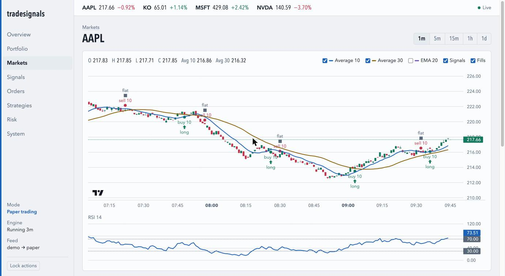
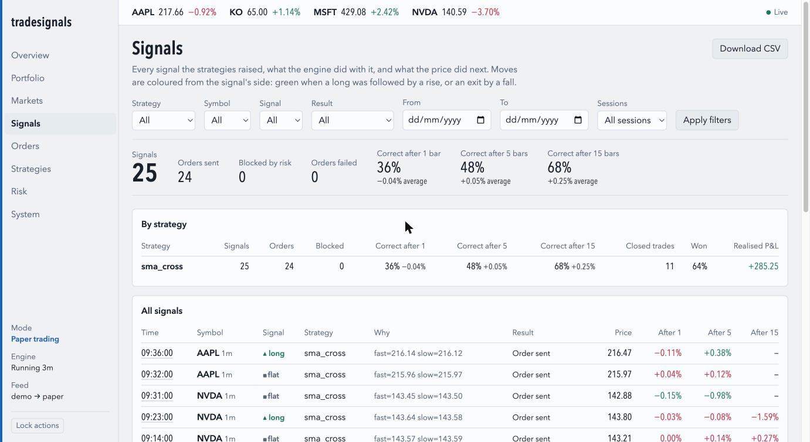

# The admin console

The admin console is a web page on your own computer that shows what the program is doing while it runs: your account, the prices, every signal and every order. With a password of your choosing it also lets you act: stop trading, close positions, place an order, start or pause a strategy. This page explains how to open it and what each part is for.

## Opening it

Install the console's extra parts once, then add `--console` to your usual command:

```bash
pip install -e ".[alpaca,console]"
tradesignals --data alpaca --broker paper --symbols AAPL,MSFT --execute --console
```

The program prints a line such as `console: http://127.0.0.1:8788 (read-only, CONSOLE_TOKEN not set)`. Open that address in your browser. The page is served by the program itself and can only be reached from the computer it runs on.

Want to look around first, without any account? Run the built-in demonstration. It makes up a market and trades it with pretend money:

```bash
python scripts/console-demo.py
```

With `--console` the program also starts keeping a record, in the file `data/tradesignals.db`. That is why yesterday's signals and orders are still there after a restart.

## Looking, and acting

Out of the box the console is **view only**. Nothing you click can send an order.

To allow actions, choose a long password, put it in `.env` as `CONSOLE_TOKEN=...`, and restart the program. A "Console token" box then appears at the bottom of the menu; type the password there once per browser. "Lock actions" makes the browser forget it.

The stripe down the left edge tells you what the program is allowed to do: blue while it trades a paper or demo account, grey when it only reports signals, amber when trading is halted.

## The pages

**Overview** is the first thing you see: what the account is worth, how today is going, how far you are below the best value of this session, your open positions, and the latest signals and orders. The line at the very top shows the latest price of each stock you follow.

**Portfolio** lists your positions with their profit or loss and how much of the portfolio each one is. Below it, "Trade history" pairs every buy with the sell that closed it and adds up what you actually made or lost. When actions are unlocked you can close a position here, cancel an order that has not filled yet, or place an order yourself.

**Markets** is for watching trends. Each stock gets a small price line, a plain word for its trend (rising when the short average is above the long one, falling when it is below) and a momentum reading. Click a stock for a full chart:



The arrows and squares on the chart are signals; the dots are orders that filled. Tick boxes above the chart switch the averages and the markers on and off, and the buttons at the top right change the bar size.

**Signals** answers "were the signals any good?". For every signal it shows what the program did with it (order sent, nothing to do, blocked by a risk limit, order failed, or not traded) and how the price moved one, five and fifteen bars later. Green means the price went the signal's way: up after "long", down after "flat". The summary on top gives the share of signals that were right, per strategy.



Click a signal's time for its story: why the strategy raised it, the order that followed, the price it filled at, and the result of the trade it opened or closed. "Download CSV" saves the list for a spreadsheet.

**Orders** is the plain history of orders.

**Strategies** shows which strategies are running and on which stocks. You can pause one (it keeps watching, but its signals are ignored), remove it, or start another with your own settings. None of this sells anything.

**Risk** shows each safety limit and how much of it is used, and holds the emergency controls described below. You can also change the limits here; the change lasts until the program is restarted.

**System** is for when something looks wrong: whether prices are still arriving, the program's own log, and a record of everything that was done from the console.

## The three emergency controls

They are on the Risk page and do different things. Know the difference before you need it.

| Control | What it does | What it does not do |
|---|---|---|
| Halt trading | Stops the program from opening or enlarging positions, at once. Strategies can still sell what you hold. | It sells nothing. |
| Close every position | Sells everything now, at the market price. You must type `FLATTEN`. | It does not stop the strategies; they may buy again unless you halt first. |
| Kill switch | Halts, cancels orders that have not filled, and stops the program. You must type `STOP`. | It does not close positions, and the console goes offline with the program. |

To get out and stay out: halt first, then close every position.

> **Warning.** After any of these, look at your broker's own app. It is the final word on what you hold.

## A view in the terminal

If you prefer not to open a browser, a compact view runs in a second terminal while the program is running with `--console`:

```bash
pip install -e ".[tui]"
tradesignals-tui
```

It shows the account, prices, positions and the latest signals and orders. Press `h` to halt or resume, `k` for the kill switch, `r` to refresh, `q` to leave. The two actions ask before they do anything and need the same password, which the view reads from `CONSOLE_TOKEN` in `.env`.

## Good to know

- The console trades paper and demo accounts only. On a live account it lets you halt and use the kill switch, nothing else.
- Every order placed from the console goes through the same safety limits as the strategies' orders.
- Times are shown in UTC, like the rest of the program.
- The "change" next to each price is measured from when the program started, not from yesterday's close.
- If the page says "Engine stopped" or "Reconnecting", the program is no longer running or is restarting; the record stays in the database.
