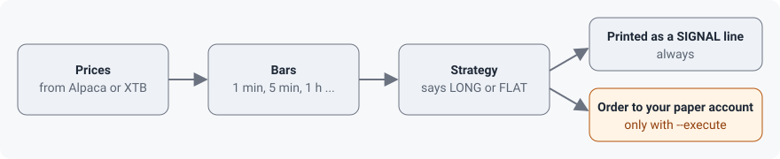

# What tradesignals does

This page is the one-screen story: what goes in, what comes out, and what the program will never do on its own.

## The pipeline

1. **Prices come in.** The program connects to a market data provider, Alpaca or XTB, and subscribes to the stocks you name. Alpaca sends price quotes and one-minute bars; XTB sends quotes.
2. **Prices become bars.** A bar summarises a stretch of time (one minute, five minutes, one hour, one day): the first price, the highest, the lowest and the last. Strategies think in bars, not in single quotes.
3. **A strategy decides.** Each time a bar is complete, the strategy looks at it and may say **LONG** (be in the stock) or **FLAT** (be out). The two built-in strategies never say "short" (bet on a fall).
4. **The decision is printed.** Every decision appears as a `SIGNAL` line in your terminal, with the reason.
5. **Optionally, an order is sent.** If you started the program with `--execute` and named a broker, the program works out the difference between what you hold and what the signal wants, runs that order through a set of risk checks, and sends a market order. Without `--execute` nothing is ever sent.

## What it is not

- **Not a backtester.** It only runs on live prices. There is no "replay last year" mode yet.
- **Not a record keeper.** Signals and orders are printed, not saved. When the program stops, its memory is gone; your broker still has the orders.
- **Not an app.** There is no window, chart or phone notification. It is a terminal program you watch or leave running.
- **Not unattended-safe.** If the connection to the provider drops, the program stops instead of reconnecting. See [Use cases and limits](use-cases.md).
- **Not a short seller.** The built-in strategies only go long or flat.

## Where the safety is

Two defaults protect you. The program is signal-only unless you pass `--execute`, and the broker connections point at paper (Alpaca) or demo (XTB) accounts unless you deliberately change a setting. Even then, executing against a live account is refused unless you add `--allow-live`. The details are in [Trust and safety](trust-and-safety.md).
